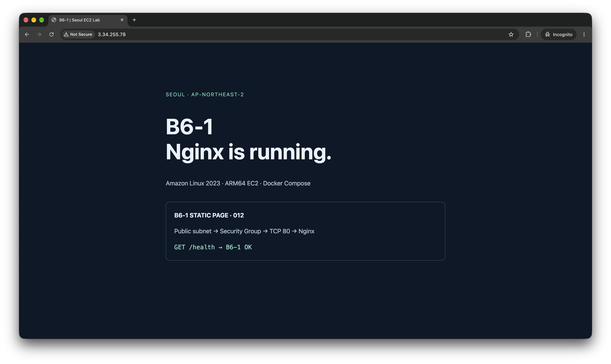
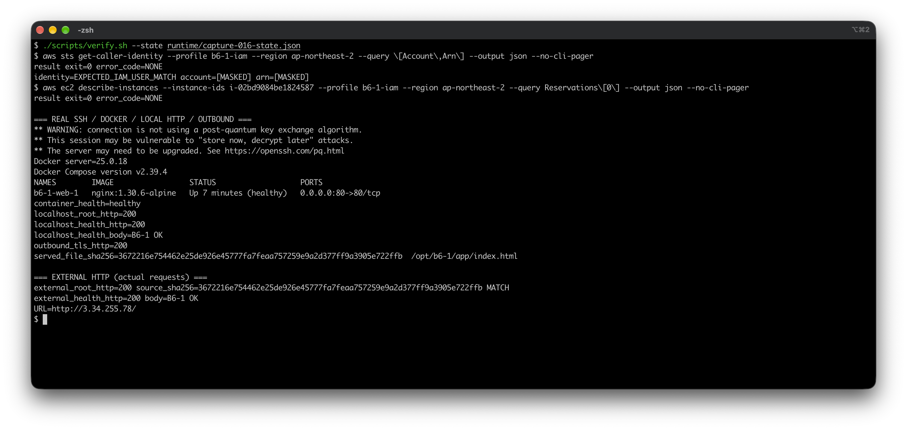

# B6-1 · AWS에서 웹 서버 만들기

간단한 정적 웹 페이지를 인터넷에 띄우면서 **AWS 네트워크가 어떻게 연결되고, 어디서 접근을 허용해야 하는지** 배우는 실습입니다. 서울 리전에 네트워크를 만들고 EC2 한 대에서 Docker와 Nginx를 실행했습니다. 접속 확인뿐 아니라 설치 로그를 읽고 문제를 구분하는 방법, 비용이 남지 않도록 자원을 정리하는 순서도 함께 익혔습니다.

2026년 10월 실습에서는 브라우저 접속, SSH, 서버 안팎의 HTTP 응답과 Docker 실행을 확인했습니다. **확인 후 서버와 이번에 만든 네트워크는 모두 삭제했습니다.** 아래 사진은 삭제 전 기록입니다.

## 결과와 제출 자료

외부 접속 검증은 **방법 A: 브라우저 접속**을 선택했습니다. 당시 주소는 `http://3.34.255.78/`입니다. 지금은 해제된 주소이므로 다시 접속하지 마세요.

| 필수 제출물 | 자료 |
|---|---|
| 구성 요소와 통신 흐름 그림 | [아키텍처 PNG](docs/architecture.png) |
| 웹 서비스 외부 접속 증명 | [실제 브라우저 사진](docs/evidence/verification/browser-page.png) |
| 문제 해결 보고서 | [증상부터 재발 방지까지](docs/troubleshooting.md#current) |
| 자원 정리 체크리스트 | [삭제 대상과 완료 기록](docs/cleanup-checklist.md) |

[사진 전체와 이전 기록](docs/evidence-guide.md) · [Shell 명령 사용법](scripts/README.md)

<details>
<summary>▶ 실제 브라우저 접속 화면 보기</summary>



주소창과 정적 페이지가 함께 보이는 실제 화면입니다. 추가로 `/health`에서도 `B6-1 OK`를 확인했습니다. 페이지의 `STATIC PAGE · 012`는 재사용한 앱의 문구이며 이번 실습 번호를 뜻하지 않습니다.

</details>

## 인터넷에서 페이지가 보이기까지

| 구성 | 맡은 역할 | 이번 설정 |
|---|---|---|
| VPC | AWS 안에서 쓰는 내 네트워크 공간 | `10.0.0.0/16` |
| 서브넷 | 그 안에서 서버를 놓는 작은 구역 | `10.0.1.0/24`, 서울 가용 영역 |
| 인터넷 게이트웨이(IGW) | VPC와 인터넷 사이의 출입구 | VPC에 연결 |
| 라우팅표 | 통신이 어느 길로 갈지 정하는 지도 | 서브넷에 연결하고 `0.0.0.0/0 → IGW` 설정 |
| EC2·Docker·Nginx | 컴퓨터·실행 상자·웹 서버 | EC2의 80번 포트를 컨테이너의 80번에 연결 |

브라우저가 **EC2의 공인 IPv4 주소로 요청**하면 **IGW → 서브넷 → 보안그룹의 80번 허용 → EC2의 80번 포트 → Docker의 80번 포트 → Nginx**로 도착합니다. 응답은 서브넷의 인터넷 경로를 따라 돌아갑니다.

길만 열어도 페이지가 뜨지는 않습니다. EC2에 공인 IPv4가 있어야 하고, 보안그룹이 HTTP를 허용하며, 서버가 실제로 해당 포트에서 요청을 받아야 합니다. 이번에는 서브넷의 자동 공인 IP 설정을 켜는 대신 **EC2 생성 때 공인 IP를 붙였습니다.** 서버에서 인터넷으로 나가는 요청도 HTTPS 응답 200으로 확인했습니다.

## 보안그룹과 IAM은 무엇이 다를까?

- **보안그룹(SG)**은 서버와 오가는 **통신**을 허용합니다. HTTP 80번은 누구나 접속하도록 열고, 관리용 SSH 22번은 당시 내 공인 IP 한 개(`/32`)만 허용했습니다. 모든 포트를 인터넷에 여는 규칙은 만들지 않았습니다.
- **IAM**은 사람이 AWS에서 할 수 있는 **작업**을 정합니다. 예를 들어 VPC 생성이나 EC2 종료를 허용합니다. HTTP 포트를 열었다고 AWS 자원을 삭제할 권한이 생기는 것은 아닙니다.

최소 권한은 실습에 필요한 작업과 자원만 허용하는 원칙입니다. 실수나 계정 정보 유출이 생겼을 때 피해 범위를 줄이기 위해 필요합니다. 이번 배포는 정해진 IAM 사용자로 실행했지만, 사용한 정책은 서울의 다른 자원과 예산·연락처 작업도 허용하므로 **최소 권한을 완전히 충족한 예제로 보기는 어렵습니다.**

## Docker로 실행한 방법

사용한 이미지는 아래 버전과 내용으로 고정했습니다. Compose는 **v2.39.4**, 실제 확인한 Docker는 **25.0.18**입니다.

```text
nginx:1.30.6-alpine@sha256:4f7cab9e1cd018f80e67f31e02dc0c6d18560b19504461c4f3dd37e5c63a74c5
```

AWS CLI로 EC2를 만들 때 [User Data](deploy/user-data.sh.tpl)를 전달했습니다. 이 스크립트가 첫 부팅 때 Docker·Compose를 설치하고 웹 페이지와 설정 파일을 `/opt/b6-1`에 배치한 뒤 서비스를 자동 실행했습니다. User Data는 관리자 권한으로 실행되므로 소스에서는 `sudo` 없이 `docker compose up -d`를 호출합니다.

아래는 실습 기록의 **EC2 서버용 실행 명령**입니다. 위 자동 실행과 같은 서비스를 시작하는 명령이며, 지금 로컬에서 실행하는 명령이 아닙니다.

```sh
cd /opt/b6-1 && sudo docker compose up -d
```

[Compose 설정](deploy/compose.yaml)의 `0.0.0.0:80:80`은 **EC2의 모든 IPv4 주소에서 받는 80번 → 컨테이너 80번** 연결입니다. 정적 페이지와 Nginx 설정은 읽기 전용으로 연결했습니다. 서버 안의 `localhost /`와 `/health`가 모두 200을 반환했고, 외부 브라우저 접속도 확인했습니다.

<details>
<summary>▶ Docker 실행 상태와 내부 HTTP 검증 화면 보기</summary>



`docker ps`에서 컨테이너가 Up·healthy인 것을 확인했습니다. 같은 화면에서 localhost `/`·`/health`와 인터넷으로 나가는 요청이 모두 200을 반환합니다.

</details>

## 로그를 보고 해결한 문제

처음 검증할 때 SSH 연결은 됐지만 `/opt/b6-1` 폴더가 없었습니다. 바로 재설치하지 않고 **자동 설치가 아직 진행 중인지** 확인했습니다. 이후 cloud-init 상태와 설치 로그에서 `done`, `B6-1 BOOTSTRAP READY`가 보였고, 같은 검증 명령을 다시 실행하자 Docker와 HTTP 확인이 성공했습니다.

원인은 설치 완료 전에 확인한 시점 차이였습니다. 재부팅·재설치·서버 재생성은 하지 않았습니다. 다음에는 연결 성공과 설치 완료를 구분하고, 상태와 로그를 먼저 확인하면 불필요한 작업을 줄일 수 있습니다. [실제 오류 → 설치 완료 → 검증 성공 사진과 6단계 보고서](docs/troubleshooting.md#current)에 과정을 남겼습니다.

## 비용과 삭제 순서

작은 서버라도 **EC2 사용 시간, EBS 저장 공간, 공인 IPv4, 데이터 전송량**에 따라 비용이 생길 수 있습니다. 예산 알림은 지출을 강제로 막는 장치가 아닙니다.

정리할 때는 EC2를 먼저 종료해 서버 사용을 끝내고, 연결된 디스크·네트워크 인터페이스·공인 IP가 정리됐는지 확인했습니다. 이어 서브넷과 라우팅표의 연결 및 인터넷 경로를 풀고, 라우팅표·서브넷·보안그룹·IGW·AWS에 등록한 키·VPC를 삭제했습니다. 연결된 자원을 먼저 풀어야 삭제 오류와 잔여 자원을 줄일 수 있습니다.

[정리 기록](docs/cleanup-checklist.md)에는 이번에 만든 대상의 삭제 결과가 있습니다. EIP·NAT Gateway·ALB·RDS는 이번 실습에서 만들지 않았습니다. 계정 전체에 없다는 뜻은 아닙니다. SSH 개인키와 사진은 로컬에 보존했고, 개인키는 Git에 포함하지 않았습니다.

<a id="limits"></a>
## 결과를 볼 때 함께 알아둘 점

| 항목 | 확인한 범위 |
|---|---|
| 무료 사용·크레딧 | 실제 적용 여부를 확인하지 못했습니다. 사용자 선택으로 t4g.nano를 썼으며, 명세의 micro급은 권장 예시입니다. |
| IAM·루트 계정 | 배포 CLI의 IAM 사용자는 확인했습니다. 계정 관리까지 포함한 모든 과정의 루트 미사용이나 전체 최소 권한을 증명한 것은 아닙니다. |
| 청구 금액 | 2026년 10월 25일에 남긴 Cost Explorer 화면에는 US$0.01이 표시됐습니다. 최신 실습만의 비용이나 최종 청구액, 크레딧 적용 여부는 알 수 없습니다. |
| 아키텍처 그림 | 같은 구성의 이전 자원 번호가 들어 있습니다. 이번 자원 번호와 삭제 결과는 사진·체크리스트에서 확인할 수 있습니다. |
| HTTPS | 선택 과제로 남겼으며 적용하지 않았습니다. |

<details>
<summary>▶ 원문 명세별 결과와 증빙</summary>

| 요구사항 | 이번 결과·증빙 |
|---|---|
| 서울 리전·Linux·EC2 한 대·EBS 8~10GiB | `ap-northeast-2`, Amazon Linux 2023 ARM64, t4g.nano 한 대, 암호화 8GiB gp3. [EC2 사진](docs/evidence/verification/compute-status.png) |
| VPC·퍼블릭 서브넷·IGW·인터넷 경로 | 각 1개, 서브넷에 라우팅표 연결, `0.0.0.0/0 → IGW`. [네트워크 사진](docs/evidence/verification/network-status.png) |
| SSH 접속·Nginx 실행·내부 HTTP 200·외부로 통신 | SSH, Docker healthy, localhost `/`·`/health` 200, 외부 HTTPS 요청 200. [검증 사진](docs/evidence/verification/docker-http.png) |
| HTTP80 공개·SSH22 내 IP만·전체 포트 공개 금지 | 두 수신 규칙만 사용, SSH는 당시 IP `/32`. [보안·키 사진](docs/evidence/provision/security-group-key.png) |
| 실습용 IAM 사용자·최소 권한·관리자 권한 금지 | 배포 IAM 사용자 확인. 당시 목록에 AdministratorAccess는 없었으나 전체 유효 권한 증명은 아니며, 정책 범위가 넓은 한계가 있습니다. [2026년 10월 25일 IAM 화면과 설명](docs/evidence-guide.md#account) |
| 외부 확인 A/B 중 하나 | **A 선택**, 브라우저 사진 보존. 추가로 [외부 `/health`](docs/evidence/verification/browser-health.png)도 확인 |
| 키 1개 안전 보관 | 이번 실행에서 키 1개 생성, 로컬 개인키 보존·Git 제외. [생성 사진](docs/evidence/provision/security-group-key.png) |
| 종료·삭제와 과금 위험 항목 확인 | EC2 종료, EBS·공인 IP 연결 제거, 이번 네트워크·AWS 키 삭제. EIP/NAT/ALB/RDS는 이번에 미생성. [정리 체크리스트](docs/cleanup-checklist.md) |
| Docker 보너스 | 위의 이미지·실행 명령·포트 연결 설명, 실제 Docker 화면과 외부 브라우저 화면 보존 |
| HTTPS 보너스 | 미적용 |

사진의 출처·날짜가 있는 계정 설정 자료·청구 화면의 범위는 [증빙 안내](docs/evidence-guide.md)에 정리했습니다. 전체 실행 명령과 단계별 촬영 방법은 [실행·운영 안내](scripts/README.md)를 참고하세요.

</details>

## 조용히 설치·삭제하기

아래 두 명령은 기존 Shell 도구의 안전 검사를 그대로 사용합니다. 설치는 **새 AWS 자원을 만들며 비용이 발생할 수 있습니다.** AWS CLI·jq 등 [기존 실행 도구](scripts/README.md)가 설치돼 있고, 실습 IAM 사용자의 권한과 로그인이 준비돼 있어야 합니다.

```sh
# 로그인이 필요할 때 별도 실행: URL·인증 코드는 내 터미널에서만 처리
aws login --profile b6-1-iam --region ap-northeast-2 --remote
# B6_EXPECTED_ACCOUNT(예상 계정 번호), B6_IAM_USER(예상 IAM 이름)를 설정하거나
# 터미널에서 실행해 필요한 입력만 받습니다. 비밀번호·접근 키는 받지 않습니다.
./install_aws.sh
./clean_aws.sh
```

정상 종료 때는 `설치 완료` 또는 `삭제 완료`만 표시합니다. 설치는 서울의 새 소형 서버를 만들고 준비 상태를 확인하며, 삭제는 **이 설치 도구가 기록한 대상만** 정리합니다. 다른 폴더에서 절대 경로로 실행해도 같습니다. 설치 중복 실행은 거부하고, 정상 삭제 후 다시 설치하면 새 대상을 만듭니다. 삭제 후에도 로컬 개인키·증빙·이전 대상 기록은 보존합니다.

기록은 Git에서 제외한 `runtime/quiet-aws/`에 저장하며, 정상 삭제 후에는 `runtime/quiet-completed-실행이름/record/`로 보관합니다. 오류에는 짧은 설명과 기록 위치만 나옵니다. 결과 불명·촬영 대기 상태나 중단된 잠금은 자동으로 지우거나 재시도하지 않습니다. 이때는 자원과 상태를 확인해 수동 조정한 뒤 진행해야 합니다. 기존 단계별 촬영은 [별도 실행 안내](scripts/README.md#capture)를 사용하세요.
