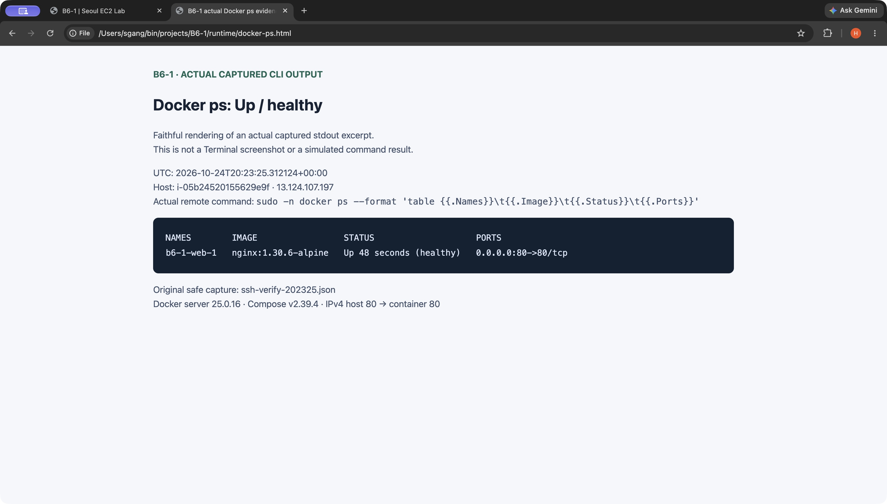

# B6-1 · Seoul EC2 Nginx

실제 서버: **[http://13.124.107.197/](http://13.124.107.197/)** · [health](http://13.124.107.197/health)

서울 `t4g.nano` 한 대에서 Docker Compose Nginx 정적 페이지를 제공한다. 외부 `/`·`/health` HTTP 200, 페이지 바이트의 소스 일치, 컨테이너 **Up (healthy)**, 실제 SSH 및 EC2의 외부 TLS 요청 200을 확인했다. **현재 실행 중이며 정리는 PENDING**이다.

## A. 외부 브라우저 접속 증빙

CUA로 실제 공개 URL을 연 Chrome 원본 화면이다. 이 외부 결과는 Docker 보너스의 브라우저 증빙도 겸한다.


## 구성과 실행

- EC2 `i-05b24520155629e9f`, `ap-northeast-2a`, `t4g.nano` ARM64 2 vCPU / 0.5 GiB. CPU credit **standard**로 생성했다.
- Amazon Linux 2023 minimal AMI `ami-05af7e49b2522f8a4`; encrypted gp3 root **8 GiB**, DeleteOnTermination=true. IMDSv2 required / hop limit 1, 인스턴스 IAM role 없음.
- [Compose](deploy/compose.yaml): 공식 Nginx `1.30.6-alpine`, ARM64 digest `sha256:4f7cab9e1cd018f80e67f31e02dc0c6d18560b19504461c4f3dd37e5c63a74c5`. **IPv4 host 80 → container 80** (`0.0.0.0:80:80`), 정적 파일·설정 read-only mount, restart unless-stopped, memory 96 MiB, 작은 로그 순환.
- 공식 Amazon signed repository Docker: 실제 server 25.0.16 / API 1.44. Compose v2.39.4 aarch64는 공식 checksum을 확인했다. root 내부 512 MiB swap 파일(0600) 사용; 기본 OS zram과 별개다.
- SG HTTP 80 전체 IPv4, SSH 22 실행 당시 현재 공인 IPv4 `/32`만 허용; 기본 아웃바운드 유지. Public subnet의 IGW 경로를 사용하며 NAT/EIP/ALB/DB/HTTPS/도메인은 만들지 않았다.

정적 원본은 [app/index.html](app/index.html), 설정은 [nginx.conf](deploy/nginx.conf)다. [UserData 템플릿](deploy/user-data.sh.tpl)에 자산을 넣는 결정적 렌더러:

```sh
python3 deploy/render-user-data.py --output runtime/user-data.sh
bash -n runtime/user-data.sh
```

실제 launch는 AWS CLI의 JSON launch fields와 **raw** `--user-data file://.../runtime/user-data.sh`를 사용했다. JSON 안에 UserData를 중복 인코딩하지 않았다. 검토된 고정 ClientToken으로 한 번 생성했으며 재생성 스크립트가 아니다.

이미 배포된 EC2에서 확인하는 방법(개인키를 공유·커밋하지 않는다):

```sh
ssh -o StrictHostKeyChecking=accept-new -o UserKnownHostsFile=runtime/known_hosts \
  -i .secrets/b6-1-ssh-key.pem ec2-user@13.124.107.197
cd /opt/b6-1
sudo -n docker compose config --quiet
sudo -n docker compose ps
curl --fail http://127.0.0.1/health
```

해당 호스트의 앱 실행 명령은 `sudo -n docker compose up -d`다. nano의 첫 부팅은 signed package 설치·SELinux scriptlet 때문에 약 10분 걸렸다. 타입 확대·재설치·추가 인스턴스 없이 완료했다.

## Docker 및 배포 검증

[상세 실행 증빙](docs/evidence/05-ec2-deploy.txt) · [안전한 명령/결과 JSON](docs/evidence/05-ec2-deploy.json)

아래는 **실제 SSH에서 캡처한 `docker ps` stdout 일부를 그대로 렌더한 화면**이다. Terminal 화면을 꾸민 것이 아니며 캡처 UTC·명령·원기록을 표시했다. PNG는 CUA 원본 screenshot bytes를 저장했다.



[아키텍처 PNG](docs/architecture.png) · [원본 SVG](docs/architecture.svg) (구성도이며 스크린샷 아님) · [실제 트러블슈팅](docs/troubleshooting.md)

## 비용·수동 단계·정리

공식 서울 요금 확인 시점 기준 compute **$0.0052/h** + public IPv4 **$0.005/h** + gp3 **$0.0912/GB-month × 8 GiB** ≈ **$0.01120/h**, **$0.2688/24h**, **$8.1756/730h**다. 세금·전송·기타 요금 제외 추정이며 Free/credit 적용 여부는 UNKNOWN이다. Budget이나 이 구성은 지출 상한을 보장하지 않는다. [EC2 공식 regional CSV](https://pricing.us-east-1.amazonaws.com/offers/v1.0/aws/AmazonEC2/current/ap-northeast-2/index.csv) · [IPv4 공식 요금](https://aws.amazon.com/vpc/pricing/).

추가 수동 설치는 필요 없다. 사용자는 실제 URL을 열어 확인하고 개인키를 로컬 비공개로 유지한다. 소스 공인 IP가 바뀌면 SSH `/32` 변경 승인을 요청하며 전체 IP로 넓히지 않는다. 서버 자동 public IP는 stop/start 후 바뀔 수 있다. 증빙 확인 후 삭제할 시점과 범위는 별도 결정해야 한다.

**아직 삭제하지 않았다.** [실제 자원별 정리 체크리스트](docs/cleanup-checklist.md)의 EC2/EBS/ENI/public IPv4와 기존 네트워크·키 참조를 따라 실제 결과를 기록해야 한다. 기존 IAM/예산/연락처/프로필을 자동 삭제하지 않는다.

이전 단계: [IAM·VPC](docs/evidence/02-cli-auth-vpc.txt) · [퍼블릭 네트워크](docs/evidence/03-public-network.txt) · [SG·키 복구](docs/evidence/04-security-keypair.txt).

## 정책 사용

[b6-1-all-in-one.json](policies/b6-1-all-in-one.json) 하나에 EC2 실습·예산 관리·이메일 연락처 확인 권한을 합쳤다. 계정/자원 ID를 치환할 필요 없이 JSON 전체를 사용한다.

1. IAM → 정책 → 정책 생성 → **JSON** 탭에서 파일 내용을 붙여넣는다.
2. 내용을 검토하고 정책 이름을 **B6-1-AllInOne**으로 저장한다.
3. 사용할 IAM 사용자를 확인하고 사용자가 직접 이 정책을 연결한다. 이 저장소에서 연결·권한 부여는 실행하지 않았다.

- EC2 조회·생성·수정·정리는 **서울(ap-northeast-2)** 요청만 허용한다.
- Budget과 이메일 연락처 작업에는 리전 조건이 없다. 예산/알림/구독 생성·변경·삭제는 `budgets:ModifyBudget`, 조회는 `budgets:ViewBudget`으로 처리한다.
- 모든 Statement는 `Resource:*`다. 계정/자원 ID, 태그, 인스턴스 타입, 수량·지출 상한 조건을 두지 않은 넓은 권한 구성이다. Budget은 강제 지출 상한이 아니다.
- Budget Actions, SNS, 태그가 있는 예산/연락처 생성, Billing 콘솔의 부가 권한, IAM 접근 키 관리 권한은 포함하지 않았다. 이메일 확인 코드는 사용자가 직접 처리한다.
- 아래 전체 정책의 모든 권한을 실제 검증한 것은 아니다. 현재 작업에서 실제 호출·런타임 검증한 단계만 확인했으며, 나머지 정책 권한까지 검증한 것은 아니다. IAM Allow는 SCP의 명시적 Deny나 닫힌 계정을 해결하지 못하며, 기존 다른 정책과의 최종 유효권한도 별도다.

공식 권한 표: [EC2](https://docs.aws.amazon.com/service-authorization/latest/reference/list_ec2.html), [Budgets](https://docs.aws.amazon.com/service-authorization/latest/reference/list_budgets.html), [이메일 연락처](https://docs.aws.amazon.com/service-authorization/latest/reference/list_notificationscontacts.html).
