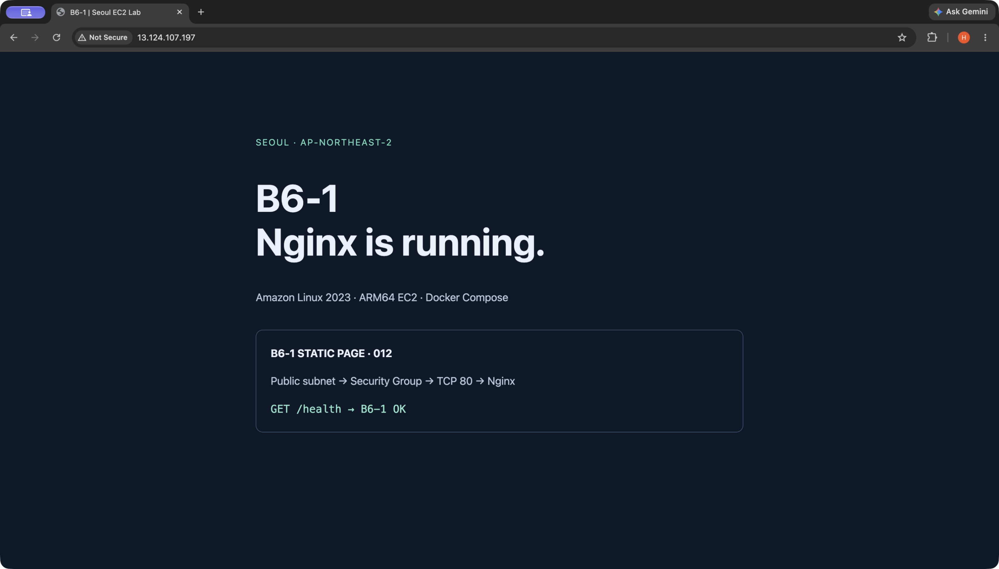

# B6-1 · EC2 웹 실습과 증빙

현재 상태는 **CLEANED**다. EC2 종료와 root EBS·자동 ENI·승인된 네트워크/클라우드 키/VPC의 정확한 부재를 확인했다. 자동 public IPv4 연결도 제거됐다. 과거 주소 `http://13.124.107.197/`는 현재 서비스가 아니며 재접속하지 않는다. 계정 전체 자원 부재나 청구 0을 뜻하지 않는다.

## 삭제 전 배포 결과 · 외부 접속 방법 A

선택한 방법은 **로컬 외부 브라우저에서 public IPv4의 HTTP 페이지에 접속**하는 방법 A다. 당시 외부 `/`·`/health` 응답은 HTTP 200이었고, `/`의 818바이트가 로컬 정적 소스와 일치했다. EC2 내부 `/health`의 `B6-1 OK`, SSH 접속, Docker healthy와 외부 TLS 요청 200도 기록했다. 이 내용은 [05 실행 기록](docs/evidence/05-ec2-deploy.txt)과 [JSON](docs/evidence/05-ec2-deploy.json)의 **과거 관측**이며 현재 실행 중이라는 뜻이 아니다.



구성은 서울 `t4g.nano` ARM64·0.5 GiB RAM, Amazon Linux 2023 minimal, encrypted 8 GiB gp3 root였다. [Compose](deploy/compose.yaml)는 아래 공식 Nginx ARM64 digest를 고정했고, Compose **v2.39.4**의 공식 checksum도 확인했다.

```text
nginx:1.30.6-alpine@sha256:4f7cab9e1cd018f80e67f31e02dc0c6d18560b19504461c4f3dd37e5c63a74c5
```

포트는 **호스트 `0.0.0.0:80` → 컨테이너 `80`** (`0.0.0.0:80:80`)이며 정적 파일과 설정은 read-only mount였다. [UserData](deploy/user-data.sh.tpl)가 앱을 배치한 **당시 EC2 서버에서의 실행 방식**은 다음과 같다. 현재 로컬에서 실행할 명령이나 삭제된 서버에 대한 재실행 지시가 아니다.

```sh
cd /opt/b6-1 && sudo docker compose up -d
```

[Docker ps 이미지](docs/evidence/05-docker-ps.png)는 실제 SSH에서 캡처한 `Up 48 seconds (healthy)` stdout 일부를 HTML로 그대로 렌더하고 CUA로 촬영한 것이다. **직접 Terminal 화면 캡처는 아니며**, 명령 결과를 만들어 낸 것도 아니다. 이미지에 명령·UTC·원기록을 표시했다. 위 외부 브라우저 이미지는 Docker 보너스의 외부 결과도 겸한다.

## 제출 자료

| 자료 | 보존한 파일 |
|---|---|
| SG 트래픽 흐름을 포함한 아키텍처 | [PNG](docs/architecture.png) · [원본 SVG](docs/architecture.svg) — 구성도이며 스크린샷 아님 |
| 선택한 외부 방법 A / 브라우저 증빙 | [외부 HTTP 원본 PNG](docs/evidence/05-external-http.png) · [05 실행 JSON](docs/evidence/05-ec2-deploy.json) |
| 실제 문제 해결 기록 | [트러블슈팅](docs/troubleshooting.md) — 증상→가설→검증→조치→결과→예방 |
| 실제 정리 결과 | [자원별 체크리스트](docs/cleanup-checklist.md) · [06 TXT](docs/evidence/06-cleanup.txt) · [06 JSON](docs/evidence/06-cleanup.json) |

## 증빙 범위와 빠진 자료

| 항목 | 현재 자료와 한계 |
|---|---|
| EC2 내부 HTTP | 내부 `/health` 성공과 외부 `/` HTTP 200은 있다. **EC2에서 직접 `localhost/`를 요청한 HTTP 200 기록은 없다.** 내부 파일 hash를 외부 응답과 대조한 것을 그 기록으로 대체했다고 주장하지 않는다. |
| IAM / 관리자 권한 부재 | [IAM JSON](policies/b6-1-all-in-one.json)과 [IAM 사용자 CLI 실행 증빙](docs/evidence/02-cli-auth-vpc.txt)은 있다. **전체 연결 정책 목록·관리자 권한 부재를 입증하는 자료는 없다.** 이 자료만으로 최소 권한 충족을 확정하지 않는다. |
| 사양 / Free·credit | 권장 micro 예시 대신 사용자의 최소 사양 선택에 따라 **nano**를 사용했다. 실제 Free·credit 적용 여부는 **UNKNOWN**이며 무료라고 주장하지 않는다. 사양 차이를 숨기거나 이것만으로 요구사항 전체 실패를 단정하지 않는다. |
| Docker ps 화면 형식 | 실제 캡처 stdout의 충실한 HTML 렌더 screenshot이다. **직접 Terminal screenshot은 없다.** |
| 삭제 후 Billing | 정확 대상 삭제 증빙은 있다. 후속 Billing 확인은 권장하지만 **그 화면/결과는 캡처하지 않았다.** |
| 선택 사항 HTTPS | 구현·검증하지 않았다. HTTP 실습 결과만 제출한다. |

추가 증빙을 만들려고 AWS를 재생성하거나 과거 기록·이미지를 보완 촬영하지 않았다. 기존 05 자료의 running/PENDING 표시는 당시 상태이며, 현재 정리 결과는 06 자료를 따른다.

## CLI와 로컬 보관

생성→status→verify→destroy의 자세한 명령은 [scripts/README.md](scripts/README.md)를 따른다. 기본은 PLAN이며 새 유료 생성에는 명시적 `--apply`와 고유 run/state가 필요하다. 새 create 전체 경로는 **mock offline 검증만** 했고 실제 유료 재생성 테스트는 하지 않았다. 실제 cleanup 및 삭제 상태 destroy NOOP는 기존 [검증 기록](docs/evidence/06-scripts-tests.txt)에 남겼다.

로컬 소스·과거 증빙·Git 이력·개인키는 보존했다. `.secrets/b6-1-ssh-key.pem`은 0600·dir0700·Git ignored이며 공유/커밋하지 않는다. IAM·예산·연락처·프로필도 삭제 대상이 아니었다.

과거 서울 비용 추정은 compute+8 GiB gp3+IPv4 약 **$0.01120/h**, 세금·전송 등 제외였다. Free/credit·실제 청구 확인을 대신하지 않으며 Budget도 강제 지출 상한이 아니다.
